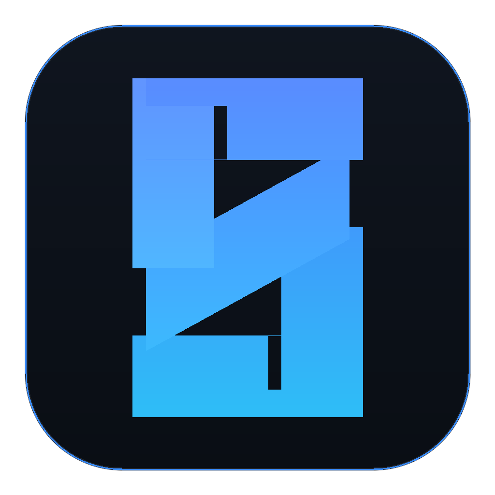
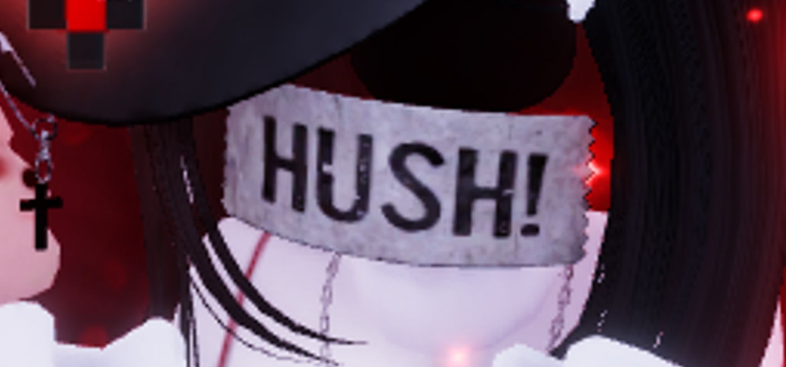
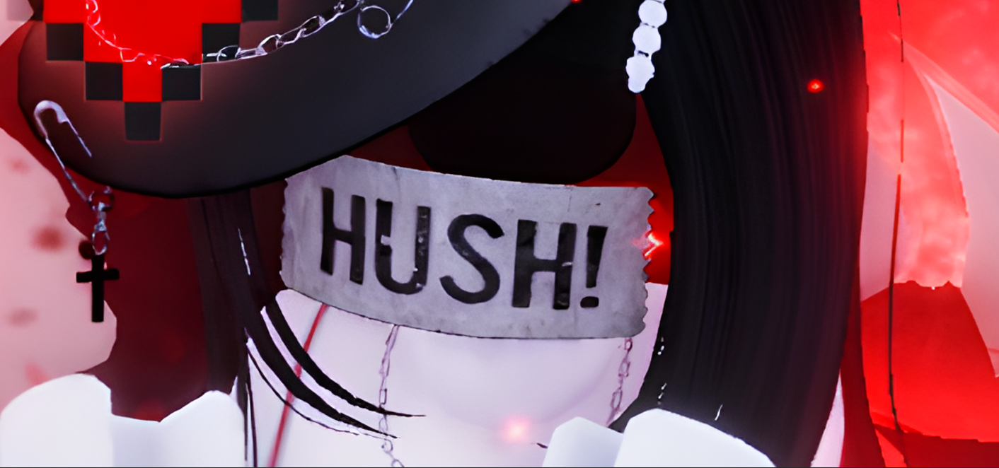

<div align="center">



# Starora AI Studio

**Super-Resolution Image & Video Enhancer for Desktop**

Offline AI upscaling powered by Real-ESRGAN NCNN Vulkan and FFmpeg with a native studio desktop interface.

[](https://github.com/mphstar/starora/releases/latest)
[-0078D6?style=flat&logo=windows)](https://github.com/mphstar/starora/releases/latest)
[](https://www.vulkan.org/)
[](LICENSE)

</div>

---

## Overview

**Starora** is a desktop application designed to restore, enhance clarity, and upscale images and videos (2x, 3x, 4x) entirely offline. All processing runs locally on your computer's GPU using Vulkan compute, without transmitting any files to external cloud servers.

Its **Split Studio Workspace** layout provides an expansive visual comparison canvas on the left paired with a responsive parameter control panel on the right.

---

## Download

Get the latest release for Windows (64-bit):

| Package | Type | Format | Download |
| :--- | :---: | :---: | :---: |
| **Windows Installer** *(Recommended)* | Setup Wizard | `.exe` | [**Download starora-setup-0.1.0-amd64.exe**](https://github.com/mphstar/starora/releases/download/v0.1.0/starora-setup-0.1.0-amd64.exe) |
| **Portable Archive** | Standalone Executable | `.zip` | [**Download starora-v0.1.0-windows-amd64-portable.zip**](https://github.com/mphstar/starora/releases/download/v0.1.0/starora-v0.1.0-windows-amd64-portable.zip) |

All releases and changelogs are also available on the [**GitHub Releases**](https://github.com/mphstar/starora/releases) page.

---

## Visual Comparison: Before vs After

<div align="center">

| Before (Original Low-Res) | After (Real-ESRGAN 4x HD) |
| :---: | :---: |
|  |  |
| *Pixelated, blurry edges, and limited fine details* | *Crisp restoration, smooth lines, and vibrant details* |

</div>

---

## Key Features

### 1. Image Super-Resolution
- **Specialized AI Models**:
  - `realesrgan-x4plus`: Optimized for real-world photos and general imagery.
  - `realesrgan-x4plus-anime`: Enhances manga lines, anime drawings, and 2D illustrations.
  - `realesrnet-x4plus`: General photo restoration with built-in noise reduction.
- **Face Restoration (GFPGAN)**: Restores subtle facial expressions and cleans up blurred portraits.
- **Flexible Output Formats**: Pure lossless PNG, optimized JPG, and WebP.

### 2. Video Super-Resolution & Timeline Scrubber
- High-precision video frame extraction powered by multi-threaded FFmpeg.
- Interactive timeline frame scrubber with playback transport controls (Play, Pause, Rewind, and Seek).
- High-quality video compression presets (H.264, H.265 / HEVC, and Apple ProRes).
- Preserves original audio tracks without fidelity loss.

### 3. Smart Storage Compression
- **Image Optimization**: Level 9 optimized PNG compression, WebP (up to ~85% size reduction), and customizable JPG quality.
- **Video Rate Control (CRF)**: CRF 18 (visually lossless master), CRF 23 (balanced streaming standard), and CRF 28 (high compression, up to ~70% space savings).
- Live real-time size comparison metrics reporting space saved.

### 4. Interactive Viewport Canvas
- **Smooth Zooming**: Use the mouse scroll wheel directly over the canvas to zoom in/out up to 1000%.
- **Pan & Drag**: Click and drag to inspect pixel-level enhancements across any region.
- **Instant Toggle**: Switch between *Before* and *After* views with zero latency.

### 5. Vulkan GPU Engine & Multi-Threading
- Multi-threaded pipeline (`-j load:proc:save`) maximizing CPU cores and GPU compute throughput concurrently.
- Hardware selector: Auto Vulkan detection, primary discrete GPU, secondary GPU, or CPU fallback.
- Automatic workspace cleanup for temporary frames and VRAM release upon task completion.

---

## System Requirements

- **Operating System**: Windows 10 / Windows 11 (64-bit)
- **GPU**: Vulkan-compatible graphics card (NVIDIA, AMD, or Intel)
- **RAM**: Minimum 8 GB (16 GB+ recommended)
- **Storage**: Minimum 2 GB free disk space for engine binaries and AI model weights

---

## Building from Source

### Prerequisites
- [Go](https://go.dev/dl/) 1.24+ installed on your system.

### Build Steps

1. **Clone the repository**:
   ```powershell
   git clone https://github.com/mphstar/starora.git
   cd starora
   ```

2. **Download dependencies**:
   ```powershell
   go mod download
   ```

3. **Run in development mode**:
   ```powershell
   go run .
   ```

4. **Compile executable binary**:
   ```powershell
   go build -o starora.exe .
   ```

5. **Run automated test suite**:
   ```powershell
   go test ./...
   ```

---

## Credits & Acknowledgements

Starora is built upon exceptional contributions from the open-source community:

- **[Real-ESRGAN](https://github.com/xinntao/Real-ESRGAN)** by Xintao Wang et al. for real-world super-resolution AI models.
- **[Real-ESRGAN NCNN Vulkan](https://github.com/xinntao/Real-ESRGAN-ncnn-vulkan)** by Nihui for portable Vulkan GPU acceleration.
- **[FFmpeg Project](https://ffmpeg.org)** for universal multimedia processing tools.
- **[MyGo UI](https://github.com/egoist/mygo)** by Egoist for the native Go desktop UI framework.

---

## License

This project is licensed under the [MIT License](LICENSE).
